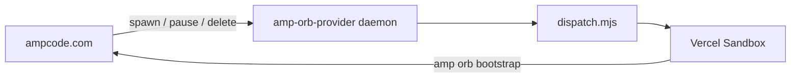

# Amp orbs on Vercel

<picture>
  <source media="(prefers-color-scheme: dark)" srcset=".github/assets/preview-dark.png">
  
</picture>

Run [Amp self-hosted orbs](https://ampcode.com/docs/orbs/self-hosted) on [Vercel Sandbox](https://vercel.com/docs/sandbox), with Amp's orb provider running as a [Vercel Daemon](https://vercel.com/docs/daemons). Each Amp thread gets its own persistent sandbox. The provider authenticates to Vercel with the daemon's [OIDC token](https://vercel.com/docs/oidc), so you don't store a Vercel access token, and you don't need Docker.

> [!NOTE]
> Vercel Daemons are in Public Beta.

## Quick start

You need an Amp workspace where you can add an orb provider, and a Vercel account with Sandbox access.

1. In your Amp workspace, open **Settings** > **Orbs**, click **Add Orb Provider**, and copy the `aop_live_…` token. Amp shows it only once.
2. Click **Deploy** and paste the token when Vercel asks for `AMP_ORB_PROVIDER_TOKEN`:

   [](https://vercel.com/new/clone?repository-url=https%3A%2F%2Fgithub.com%2Fatinux%2Famp-orbs-on-vercel&project-name=amp-orbs-on-vercel&repository-name=amp-orbs-on-vercel&env=AMP_ORB_PROVIDER_TOKEN&envDescription=The%20aop_live_%20token%20of%20a%20custom%20orb%20provider.%20Create%20one%20in%20your%20Amp%20workspace%20settings%20under%20Orbs.&envLink=https%3A%2F%2Fampcode.com%2Fworkspace%23custom-orb-providers)

3. Follow [Scheduled provider lifecycle](#scheduled-provider-lifecycle) to configure the control credentials and redeploy. The provider defaults to zero instances.
4. In the Vercel project dashboard, open **Schedules**, select `amp-provider-start`, and click **Run Schedule**. Verify the daemon reaches one healthy instance.
5. Start a thread in Amp, click **Orb**, and choose your provider under **Self-Hosted**.

The first deployment takes a few minutes, because it copies Amp's orb image. Run one provider per Amp provider token.

## How it works

The following diagram shows how a thread gets an orb:



The project declares two daemons in `vercel.json`:

| Daemon | Instances | Purpose |
| --- | --- | --- |
| `amp-orb-provider` | 0 by default, 1 while scheduled on | Runs `amp orb provider`, which receives jobs from Amp and runs `provider/dispatch.mjs` for each one. |
| `orb-image` | 0 | Never runs. Each deployment builds it from Amp's orb image and pushes it to Vercel Container Registry (VCR) as `daemon.orb-image`. |

For each job, `dispatch.mjs` does the following:

- `spawn` creates or resumes a persistent sandbox named after the orb, then starts `amp orb bootstrap` inside it. A new orb boots from the newest image in `daemon.orb-image`.
- `pause` stops the sandbox. Vercel keeps the files but not the memory.
- `delete` stops the sandbox, deletes its snapshots, and deletes the sandbox.

Orbs use 2 vCPUs and 4 GB of memory, and stop after 40 minutes at most. A paused orb's snapshot expires 30 days after its last pause.

## Deploy with the CLI

To deploy from your own clone instead of the Deploy button, use the [Vercel CLI](https://vercel.com/docs/cli). This also lets you store the token as a sensitive environment variable.

1. Clone this repository and link it to a new Vercel project:

   ```sh
   vercel link
   ```

2. In your Amp workspace, open **Settings** > **Orbs** and click **Add Orb Provider**.
3. Copy the `aop_live_…` token. Amp shows it only once.
4. Store the token as a sensitive Production environment variable. The CLI prompts for the value:

   ```sh
   vercel env add AMP_ORB_PROVIDER_TOKEN production --sensitive
   ```

5. Configure the production control credentials listed in [Scheduled provider lifecycle](#scheduled-provider-lifecycle). Deploy to production. Daemons run only in production:

   ```sh
   vercel --prod
   ```

6. Run `amp-provider-start` from the Vercel dashboard's **Schedules** tab and verify the provider is healthy. In Amp, start a thread, click **Orb**, and choose your provider under **Self-Hosted**.

## Credentials

| Credential | Lifetime | Where it's stored |
| --- | --- | --- |
| Vercel OIDC token | Short-lived. Vercel refreshes it for the daemon. | Nowhere. The SDK reads it from the daemon's token file for each job. |
| Amp provider token | Long-lived, until you delete the provider in Amp | A sensitive environment variable |
| Vercel control API token | Until expiry or revocation | Sensitive Production environment variable `VERCEL_CONTROL_TOKEN`, read by the scheduled functions |

## Scheduled provider lifecycle

Two [Vercel Schedules](https://vercel.com/docs/schedules/configuration) control only `amp-orb-provider` in `iad1`. They run independently of the daemon, so they can start it from zero without a redeploy.

| Schedule | Daily time in Asia/Kolkata | Requested instances |
| --- | --- | --- |
| `amp-provider-start` | 5:00 PM | 1 |
| `amp-provider-stop` | 5:00 AM | 0 |

On Hobby, the mandatory jitter window is 15 minutes, so these times are approximate. Edit `schedule` and `timezone` in `vercel.json` and redeploy to change the hours. See [schedule configuration](https://vercel.com/docs/schedules/configuration#schedule-properties).

### Configure and deploy

Use a current Vercel CLI with Schedules support. The root package requires Node.js 24. Scheduled functions have their own root package and lockfile; the provider image continues to use `provider/package-lock.json`.

Add these **Production** environment variables to the same project:

| Variable | Value |
| --- | --- |
| `VERCEL_CONTROL_TOKEN` | Vercel API token scoped to the owning account or team, with project-update permission. Store as sensitive. |
| `DAEMON_PROJECT_ID` | ID of this project, such as `prj_...`, available under project settings |
| `DAEMON_TEAM_ID` | Owning team ID, such as `team_...`, when applicable |

The CLI prompts for each value without putting it in shell history:

```sh
vercel env add VERCEL_CONTROL_TOKEN production --sensitive
vercel env add DAEMON_PROJECT_ID production
# For team-owned projects:
vercel env add DAEMON_TEAM_ID production
npm ci --ignore-scripts
npm run check
npm test
vercel --prod
```

Keep `AMP_ORB_PROVIDER_TOKEN` configured too. The control token authenticates the scaling API; `dispatch.mjs` continues to authenticate Sandbox and VCR requests only with OIDC. These functions reject execution unless `VERCEL_ENV` is `production`, so preview or local runs cannot change the production daemon. Don't manually set that system variable in other environments.

The functions use [private schedule triggers](https://vercel.com/docs/schedules/handle-runs#function-targets), with no public URL and no `CRON_SECRET`. Never place tokens in source or `vercel.json`. Project environment variables may also be available to daemons; do not treat the function package boundary as credential isolation.

A fresh deployment defaults to zero instances and waits for a start run. Existing [scaling overrides](https://vercel.com/docs/daemons/managing-daemons#scaling-a-daemon) persist across deployments, so this default does not reset a previously running daemon. Run the stop schedule to explicitly save a zero override when needed.

### Manual operation and verification

Open **Project > Schedules**, select `amp-provider-start` or `amp-provider-stop`, and click **Run Schedule**. Manual runs leave the recurring times unchanged.

1. Run start and check **Daemons > amp-orb-provider** for one healthy instance and a connection in Amp. A successful schedule confirms the override was saved, not daemon readiness.
2. Create a test Amp orb, write a file, then finish the task and pause the orb. Confirm its snapshot remains.
3. Run stop and verify the daemon reaches zero instances.
4. Run start again and resume the same Amp thread to verify the file persists. Repeat start or stop to confirm the count stays at one or zero.
5. Review schedule execution history, function logs, daemon status, and usage. Stop the provider when finished testing.

The helper uses an absolute, repeatable [instance override](https://vercel.com/docs/rest-api/daemons/override-a-project-daemon-s-instance-counts), a 15-second request timeout, and requires `{ "ok": true }`. Each function has a 30-second duration limit. Logs include the schedule name and execution ID, and failures propagate into execution history without logging credentials or API response bodies. Private function targets have no automatic retries. If a run fails, inspect its history and rerun it, or scale the daemon from the dashboard. Rotate an expired token in Production and redeploy.

### Manual start API

Send `POST /api/manual-start-provider` with `Authorization: Bearer <secret>`. Set `AMP_PROVIDER_API_SECRET` as a sensitive Production environment variable and redeploy to enable it. Use a separate random secret of at least 32 bytes, rather than the Vercel control token. The secret authorizes only this start operation. Without it configured, the endpoint returns `503`; missing or incorrect credentials return `401`.

```sh
curl --fail-with-body -X POST \
  https://amp-orbs-on-vercel-provider.vercel.app/api/manual-start-provider \
  -H "Authorization: Bearer $AMP_PROVIDER_API_SECRET"
```

Replace the domain with your project's production domain when deploying another copy. Keep the secret out of URLs and source control. For this checkout, the generated secret is saved in the gitignored `.env.manual.local` file with owner-only permissions. Load it into your shell before the command above:

```sh
set -a
. ./.env.manual.local
set +a
```

A successful request returns HTTP `202` and `{ "ok": true, "daemon": "amp-orb-provider", "instances": 1, "status": "requested" }`. It confirms the instance override was saved, not that Amp is connected yet. Repeating the request keeps the count at one. Scaling failures return `502`. Preview deployments cannot scale production. If Deployment Protection covers your production domain, callers also need Vercel's protection credentials.

This endpoint can start the provider even if the recurring start schedule is disabled. It does not enable or disable schedules or extend the next 5 AM stop. If you disabled the stop schedule too, you must stop the daemon manually. Use the dashboard's stop schedule for manual shutdown.

### V1 limits

Stopping the provider can interrupt an in-flight dispatch operation. V1 does not detect active work, drain jobs, stop running sandboxes, or delete snapshots. Finish and pause Amp tasks before 5 AM and check running sandboxes separately. While the provider is off, Amp cannot dispatch spawn, pause, or delete requests through it.

A manual start after the 5 AM cutoff remains on until you manually stop it or the next daily stop runs. There is no automatic manual-session expiry, extra shutdown retry, or quota enforcement. Active-orb protection and those controls are deferred to v1.1. At 1 GiB for twelve hours daily, the nominal provider memory usage is 360 GiB-hours over 30 days, before jitter, failures, and manual sessions. Sandbox, CPU, registry, and snapshot usage are separate.

To validate locally without cloud mutations, run `npm ci --ignore-scripts`, `npm run check`, and `npm test` at the root. The tests mock Vercel's API and exercise both real schedule wrappers. Live deployment and the start/pause/stop/resume checks above are still required to verify your project's configuration.

## Pinned dependencies

The root Schedules SDK and development tools are pinned to exact versions too. Both packages override `zod` to `4.6.7`. For root upgrades, use `npm install --save-exact`, review lockfile version and integrity changes, and run `npm audit --omit=dev`, `npm run check`, and `npm test`.

The provider daemon can obtain the project's OIDC tokens, so its image only runs code pinned in `provider/package-lock.json`:

- The Amp CLI comes from npm (`@ampcode/cli`) at an exact version, not from a remote install script. Its platform binaries are optional dependencies with integrity hashes in the lockfile.
- The Sandbox and OIDC SDKs are pinned to exact versions. An npm override pins `zod` to a release that fixes [GHSA-mrhx-c7xc-m3w5](https://github.com/advisories/GHSA-mrhx-c7xc-m3w5).
- The Docker build runs `npm ci --ignore-scripts`, so no package script runs until npm has verified every package. Amp's setup script then places the binary, and `amp --version` fails the build if the binary is missing.
- `AMP_SKIP_UPDATE_CHECK=1` stops the CLI from updating itself at runtime.

## Update Amp's orb image

Each production deployment rebuilds `daemon.orb-image` from Amp's latest image. New orbs use the newest build; existing orbs keep the image they started from. To pick up a new Amp image, redeploy:

```sh
vercel --prod
```

## Update the Amp CLI and SDKs

The provider keeps the pinned versions until you change them. To upgrade, review the new release, then update the exact pin and the lockfile together:

```sh
cd provider
npm install --save-exact @ampcode/cli@<approved-version>
npm audit --omit=dev
```

Review the version and `integrity` changes in `package-lock.json`, commit `package.json` and `package-lock.json` together, and redeploy. Never regenerate the lockfile during the Docker build, and never replace an integrity hash to get past a mismatch; investigate it instead.

## Costs

The provider daemon is billed for Active CPU and Provisioned Memory (1 GiB) while it runs. Orbs are billed as Vercel Sandbox usage: Provisioned Memory while they run, and Snapshot Storage while they're paused. See [Sandbox pricing](https://vercel.com/docs/sandbox/pricing) and [Daemons limits](https://vercel.com/docs/daemons/limits).

To stop all charges:

1. Disable both lifecycle schedules in the Vercel dashboard so the next start cannot turn the provider back on. Scale `amp-orb-provider` to zero in every region through **Daemons** > **Scale**. Scaling overrides survive redeploys, so changing `vercel.json` alone may not stop it.
2. Remove the remaining sandboxes and their snapshots:

   ```sh
   vercel sandbox list
   vercel sandbox remove <sandbox-name> --delete-orphan-snapshots
   vercel sandbox snapshots list
   ```

3. Delete both daemon image repositories, which keep billing for VCR storage. The next deployment builds them again:

   ```sh
   vercel vcr rm daemon.orb-image
   vercel vcr rm daemon.amp-orb-provider
   ```

## Test the dispatch program locally

`dispatch.mjs` authenticates only with OIDC. To run it on your computer, pull the project's development OIDC token, which expires after 12 hours:

```sh
vercel env pull
cd provider
npm ci --ignore-scripts
export ORB_ID=amp-dispatch-test-$(date +%s) ORB_TOKEN=fake
for op in spawn spawn pause delete delete; do ORB_OPERATION=$op node --env-file=../.env.local dispatch.mjs; done
```

Deploy the project once first, so `daemon.orb-image` exists. The fake `ORB_TOKEN` can't connect to Amp, but the run checks sandbox creation, resume, pause, and cleanup.

## Troubleshoot

- **`Could not get credentials from OIDC context`:** The dispatch program has no OIDC token. It runs on the daemon, or locally after `vercel env pull`.

- **`No ready image in daemon.orb-image`:** Deploy the project to production to build the image.
- **The thread waits at "Creating orb":** Check the `amp-orb-provider` daemon logs in the Vercel dashboard. Make sure no other provider uses the same token.
- **Environment variable changes have no effect:** Daemons receive environment variables at deployment. Redeploy to production.
